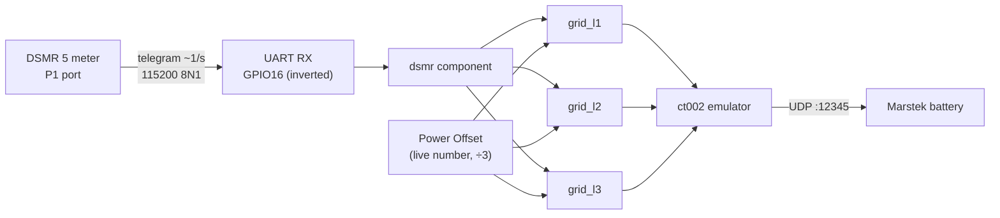
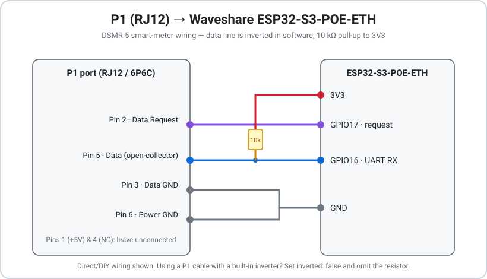
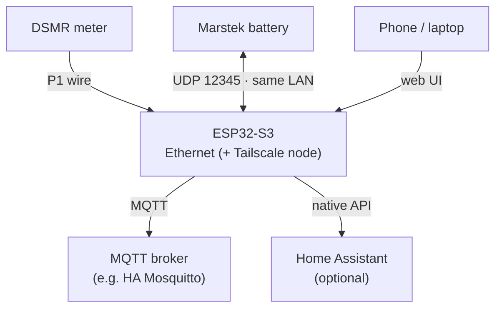

# ESPHome — DSMR P1 → AstraMeter CT002 (Marstek)


-0969da)

An ESPHome config that reads a Dutch **DSMR 5 (P1)** smart meter and feeds the signed
per-phase grid power into the **[AstraMeter](https://github.com/tomquist/astrameter)
`ct002` component**, emulating a **Marstek CT002** grid sensor. Marstek storage
batteries then steer toward zero grid (self-consumption / zero-export) — no Marstek
cloud, no CT clamp, no extra dongle. Runs on a **Waveshare ESP32-S3-POE-ETH** over wired
PoE Ethernet.

## Contents

- [The two variants](#the-two-variants)
- [How it works](#how-it-works)
- [Hardware](#hardware)
- [Wiring](#wiring)
- [GPIO usage](#gpio-usage)
- [Network & remote access](#network--remote-access)
- [Repository layout](#repository-layout)
- [Installation](#installation)
- [Configuration](#configuration)
- [Entities](#entities)
- [Upgrading](#upgrading)
- [Performance & resource usage](#performance--resource-usage)
- [Troubleshooting](#troubleshooting)
- [Credits](#credits)

## The two variants

Both are **fully self-contained** single files (no shared includes) and identical except
for remote access — pick one:

| | [`…simple.v3.yaml`](astrameter-ct002-dsmr.simple.v3.yaml) | [`…simple.tailscale.yaml`](astrameter-ct002-dsmr.simple.tailscale.yaml) |
|---|---|---|
| DSMR P1 reader → ct002 emulator | ✅ | ✅ |
| Web UI (v3) + OTA firmware upload | ✅ | ✅ |
| Power offset (live, split over the phases) | ✅ | ✅ |
| MQTT + ct002 `mqtt_insights` | ✅ | ✅ |
| Home Assistant native API | ✅ (optional) | ✅ (optional) |
| **Tailscale node** (remote web UI / OTA, tailnet MQTT broker) | — | ✅ |
| Reachability | LAN only | LAN + anywhere on the tailnet |

Choose **Simple V3** if the device, the batteries, and your MQTT broker all live on the
same LAN. Choose **Simple V3 + Tailscale** if you want the web UI and OTA reachable from
anywhere without port-forwarding, or your broker is only reachable over the tailnet.

> The two files are deliberately kept in **lockstep**: any change that isn't
> Tailscale-specific is mirrored to both. If you edit one, apply the same change to the
> other.

## How it works



Each phase is computed as `(power_delivered − power_returned) × 1000 + offset ÷ 3`, in
**watts**:

- **positive** = consumption / grid **import**
- **negative** = production / grid **export**

This is exactly the sign convention the `ct002` component expects. All three phases (plus
the total) recompute **together once per telegram** — triggered by the last power value in
the telegram — so ct002 always sees a consistent 3-phase snapshot, ~1× per second on SMR5.
The emulator reads the latest values on each Marstek battery UDP poll.

The single **Power Offset** (−300…+300 W, adjustable live from HA or the web UI,
persisted across reboots) is split equally over the three phases in **whole watts**
(offset ÷ 3, truncated toward zero — e.g. 10 W becomes 3 W per phase) and added before
ct002 sees the values, shifting the zero-grid target: a **positive** offset makes the
batteries discharge more, settling the real grid into **export** to the net; a
**negative** offset settles it into **import** from the net. E.g. +30 W makes each real
phase settle near −10 W (≈30 W total export).

The device runs **fully standalone**: Home Assistant is optional, and
`reboot_timeout: 0s` on both `api:` and `mqtt:` keeps it alive even if HA or the broker
is unreachable.

## Hardware

| Spec | Value |
|------|-------|
| Board | Waveshare **ESP32-S3-POE-ETH** |
| Module | ESP32-S3-WROOM-1(U)-**N16R8** |
| MCU | ESP32-S3, Xtensa LX7 dual-core @ 240 MHz |
| Flash | 16 MB |
| PSRAM | 8 MB **octal** (mandatory for the Tailscale variant) |
| Ethernet | **W5500** over SPI, 10/100 Mbps, **PoE** |
| Power | PoE (802.3af) or USB-C |

## Wiring

Only the **P1 port** needs wiring — Ethernet and power are on-board (PoE/USB-C).



The P1 port is an **RJ12 (6P6C)** socket. Connect 4 of its 6 wires:

| P1 pin | Signal | → board | Notes |
|--------|--------|---------|-------|
| 2 | Data Request (RTS) | **GPIO17** | driven HIGH by ESPHome to request telegrams |
| 3 | Data GND | **GND** | ground for the data signal |
| 5 | Data (RxD) | **GPIO16** | **add a 10 kΩ pull-up to 3V3** |
| 6 | Power GND | **GND** | |
| 1, 4 | +5V / NC | — | leave unconnected |

**Why the pull-up + inversion:** the P1 data line is open-collector and logically inverted.
The 10 kΩ pull-up to 3V3 sets the idle level, and `inverted: true` on the UART RX pin flips
it back in software. If you use a **ready-made P1 cable with a built-in inverter**, set
`inverted: false` in the `uart:` block and omit the external resistor.

The P1 pins (`dsmr_rx_pin`, `dsmr_request_pin`, `dsmr_baud_rate`) are substitutions at the
top of both configs — change them if your wiring differs.

## GPIO usage

| GPIO | Function |
|------|----------|
| 9 | W5500 reset |
| 10 | W5500 interrupt |
| 11 | W5500 MOSI |
| 12 | W5500 MISO |
| 13 | W5500 SCLK |
| 14 | W5500 CS |
| 16 | P1 UART RX (inverted) |
| 17 | P1 data request (RTS) |
| 33–37 | Octal PSRAM (reserved — do not use) |
| 43 / 44 | USB-serial console (logger) |

## Network & remote access



- **Simple V3:** everything on the LAN. The web UI is at `http://<device-ip>/`; the MQTT
  broker must be reachable from the LAN.
- **Simple V3 + Tailscale:** the device joins your **tailnet as a real node** (via
  [esphome-tailscale](https://github.com/Csontikka/esphome-tailscale)), so the web UI —
  including the OTA firmware upload — is reachable from anywhere with no port-forwarding,
  at the node's `100.x.y.z` address or its MagicDNS name (`http://astrameter-ct002-dsmr/`).
  Outbound connections ride the tunnel too, so `mqtt_broker` can be your HA host's
  Tailscale IP or MagicDNS name. See
  [Upgrading the Tailscale package](#upgrading-the-tailscale-package) for the caveats.

## Repository layout

| File | Purpose |
|------|---------|
| [`astrameter-ct002-dsmr.simple.v3.yaml`](astrameter-ct002-dsmr.simple.v3.yaml) | **Simple V3** — self-contained: board, Ethernet, P1/DSMR reader, meter sensors, power offset, CT002 emulator, web UI + OTA, MQTT + mqtt_insights |
| [`astrameter-ct002-dsmr.simple.tailscale.yaml`](astrameter-ct002-dsmr.simple.tailscale.yaml) | **Simple V3 + Tailscale** — the same, plus the device joins your tailnet (remote web UI/OTA, tailnet MQTT) |
| [`secrets.yaml.example`](secrets.yaml.example) | Template for `secrets.yaml` (which is gitignored) |
| [`docs/wiring.svg`](docs/wiring.svg) | P1 wiring diagram |

## Installation

```bash
git clone https://github.com/Maart3nL/esphome-astrameter-dsmr.git
cd esphome-astrameter-dsmr
cp secrets.yaml.example secrets.yaml      # then fill in the values

# pick ONE variant — first flash over USB; later flashes via OTA / the web UI:
esphome run astrameter-ct002-dsmr.simple.v3.yaml
# …or:
esphome run astrameter-ct002-dsmr.simple.tailscale.yaml
```

Fill in `secrets.yaml`:

| Secret | Needed by | How to get it |
|--------|-----------|---------------|
| `web_username` / `web_password` | both | choose — gates the web UI **and** OTA upload (remotely reachable in the Tailscale variant, so make it strong) |
| `api_encryption_key` | both | `openssl rand -base64 32` |
| `ota_password` | both | `openssl rand -hex 16` |
| `ct_mac` | both | `""` = mirror each battery's own CT MAC (default), or a fixed 12-hex MAC |
| `mqtt_broker` | both | broker host/IP — LAN address (V3) or your HA host's Tailscale IP / MagicDNS name (Tailscale variant) |
| `mqtt_username` / `mqtt_password` | both | your broker credentials |
| `tailscale_auth_key` | Tailscale only | Tailscale admin → Settings → Keys → *Generate auth key* (reusable + ephemeral) |

**Tailscale variant only:** after the device first connects, open it in the Tailscale
admin console and **Disable key expiry**, or the node drops off the tailnet after ~180
days.

## Configuration

- **AstraMeter version** — a single substitution at the top of each file
  (`astrameter_version: "2.2.3"`), used to pin the `ct002` external component to a release
  tag. See [Upgrading AstraMeter](#upgrading-astrameter-the-ct002-component).
- **ct002 tuning** — the emulator runs on the component's **built-in defaults** for
  filters/saturation; only a handful of knobs are set directly in the `ct002:` block.
  Notably, four `balancer:` values (`grid_predict_trust`, `pace_base_step`,
  `osc_damp_max`, `import_trim_w`) are **zeroed and `efficiency_demand_alpha` set to 1**,
  which switches AstraMeter 2.2.x's adaptive controller back to the crisp 2.1.2 behavior:
  act on the raw meter and send the full correction immediately. The 2.2.x machinery
  (predictor, ramp pacing, oscillation damping) is tuned for laggy multi-second meters and
  multiple batteries per phase — with a fast 1 Hz DSMR feed and one battery per phase it
  only adds reaction lag and overshoot. These are **compile-time**: edit and re-flash.
- **Power offset** — the only *runtime* tuning: a single `Power Offset` number
  (−300…+300 W), adjustable live from HA or the web UI, persisted across reboots, applied
  instantly. Split equally over L1/L2/L3 in whole watts; **positive = more export to the
  net, negative = more import from the net.**
- **Secrets** — anything environment-specific (broker, credentials, keys) lives in
  `secrets.yaml` and is referenced via `!secret`, so nothing identifying is in this public
  repo.
- **Standalone** — keep or delete the `api:` block depending on whether you use Home
  Assistant. Either way the emulator and web UI work without it. `discovery: false` on
  `mqtt:` suppresses ESPHome's own MQTT discovery (the native API already exposes the
  entities to HA); ct002's `mqtt_insights` discovery for the batteries is separate and
  stays on.

## Entities

All non-internal entities appear automatically in the web UI and (via the API) in Home
Assistant:

- **Meter:** `Grid Power L1/L2/L3` + `Grid Power Total` (W, per-telegram), `Voltage
  L1/L2/L3` (30 s averaged; blank if your meter doesn't report them).
- **Controls:** a `Power Offset` number and a `Restart` button.
- **Diagnostics:** `Uptime`, `ESP Temperature`, `ESPHome Version`, `IP Address`, `Status`
  (online/offline).
- **Tailscale variant only:** `VPN Connected`, `VPN IP`, `VPN Peers`, `Device Memory`,
  a `Reboot` button and more (provided by the Tailscale package), plus a `VPN Disable
  (stop auto-connect)` button — turns the package's "VPN Enabled" switch off
  (persisted), so the VPN stays down across reboots until you switch it back on.
- **Batteries (via MQTT):** ct002's `mqtt_insights` publishes HA Device Discovery for
  each connected Marstek battery and answers Marstek-app polls on the broker. Note the
  per-battery devices include their own `Grid Power L1/L2/L3` sensors — these look like
  duplicates of the meter entities above but are per-battery views; that's expected.

## Upgrading

> General rule: bump the version, **validate, then compile** before flashing, and keep the
> old version handy to roll back. Keep ESPHome itself current too —
> `pip install -U esphome` (or update the add-on/Docker image) — since newer component
> features can require a newer ESPHome. And remember: **apply the same bump to both
> variant files.**

### Upgrading AstraMeter (the ct002 component)

The version is a single substitution (in **both** files):

```yaml
substitutions:
  astrameter_version: "2.2.3"      # ← bump this one line

external_components:
  - source: github://tomquist/astrameter@${astrameter_version}
    components: [ct002]
    refresh: never                 # tag is immutable
```

1. **Check for a release:** <https://github.com/tomquist/astrameter/releases>
   (or `git ls-remote --tags https://github.com/tomquist/astrameter.git`).
2. **Read the [CHANGELOG](https://github.com/tomquist/astrameter/blob/main/CHANGELOG.md)**
   between your version and the target — especially any `### Breaking` section and anything
   mentioning **ESPHome / `ct002` / a renamed key**. The ct002 ESPHome component is still
   flagged *experimental*, so its YAML schema can change between releases. Watch the
   `balancer:` keys in particular — this config zeroes several of them to keep 2.1.2-style
   control (see [Configuration](#configuration)), and a release could rename or re-scope
   them.
3. **Bump** `astrameter_version` to the new tag in both files.
4. **Validate** (no flashing): `esphome config astrameter-ct002-dsmr.simple.v3.yaml` —
   catches renamed/removed config keys.
5. **Compile:** `esphome compile astrameter-ct002-dsmr.simple.v3.yaml`.
6. **Flash:** `esphome run astrameter-ct002-dsmr.simple.v3.yaml` (or the Tailscale file).
7. **Verify behavior on-device:** with active control on, the grid should track ~0 W
   crisply after load steps. Then **roll back** anytime by setting `astrameter_version`
   back to the old tag and re-flashing — pinned tags make every build reproducible.

### Upgrading the Tailscale package

*(Tailscale variant only.)*

```yaml
packages:
  tailscale:
    url: https://github.com/Csontikka/esphome-tailscale
    ref: v0.4.2   # ← pinned release tag (glue yaml)
    files: [packages/tailscale/tailscale.yaml]
    refresh: 1d
```

> **What the pin does (and doesn't):** `ref:` pins the package's **glue yaml** — the
> entity/time/switch definitions this config consumes — to a tagged release. The glue
> itself pulls the actual Tailscale **C++ component from `@main`** (hardcoded upstream
> with `refresh: 0s`), so the compiled component always tracks upstream main regardless
> of this pin. In practice a rebuild can still pull new C++ code; the pin only keeps the
> YAML surface stable.

To update the pin deliberately:

1. **Check the newest release:** <https://github.com/Csontikka/esphome-tailscale/releases>.
2. **Set `ref:`** to the new tag.
3. **Force a clean rebuild:** `esphome clean astrameter-ct002-dsmr.simple.tailscale.yaml`
   then `esphome compile astrameter-ct002-dsmr.simple.tailscale.yaml`. The component is
   native C++, so a **compile** is the real test — `esphome config` alone won't catch C++
   changes.
4. **Flash, then verify on-device:** the `VPN Connected` sensor turns on and `VPN IP`
   populates. Re-confirm **Disable key expiry** is still set for the node in the Tailscale
   admin console, and glance at the `Device Memory` sensor.
5. **Roll back** by setting `ref:` to the previous tag and rebuilding (though note the
   `@main` caveat above — the C++ side doesn't roll back with it).

> Caveats: the component is third-party and experimental, sets global lwIP `sdkconfig`
> options (shared with the W5500 driver), requires octal PSRAM, and caps tunnel throughput
> at ~2–5 Mbit/s.

### Upgrading ESPHome itself

```bash
pip install -U esphome      # or update the Home Assistant add-on / Docker image
esphome config astrameter-ct002-dsmr.simple.v3.yaml   # re-validate to surface new deprecations
```

Do this **before** a big component bump. It also surfaces deprecations early — e.g. a `/` in
an entity name (auto-fixed today) becomes a hard error in ESPHome 2026.7.0.

## Performance & resource usage

- **Compiler:** built with `compiler_optimization: PERF` (-O2 — speed over size; with
  16 MB flash the size cost is irrelevant).
- **lwIP sockets:** `CONFIG_LWIP_MAX_SOCKETS` is raised to **32**. The config stacks
  several socket users — ct002's UDP responder, MQTT, the native API, the OTA listener,
  mDNS, and the web server (up to ~9 at peak) — for a worst case around 20 concurrent,
  plus a handful more for Tailscale's control plane in that variant.
- **Ethernet SPI:** the W5500 runs at 40 MHz for lower latency on the UDP/API path; drop
  to 33 MHz if your board is unstable.
- **CPU:** light at idle (one telegram/sec, a few ct002 polls/sec). In the Tailscale
  variant the real ceiling is **WireGuard crypto** — software ChaCha20 on the S3 — which
  caps the tunnel at ~2–5 Mbit/s; expect brief spikes during remote use, OTA, or live
  web-UI streaming.
- **Memory:** the app image fits comfortably in the auto-sized ~8 MB app partition, and
  the 8 MB PSRAM stays mostly free. If a build ever runs tight, set `web_server:
  local: false` to load the UI assets from a CDN instead of embedding them.

## Troubleshooting

| Symptom | Check |
|---------|-------|
| No telegrams parsed | `inverted: true` set, 10 kΩ pull-up present, wire on GPIO16, baud 115200 |
| ct002 not detected by battery | device + battery on the same subnet; UDP 12345 open; battery in **Self-Adaptation** mode |
| Grid values frozen / batteries idle | `max_sensor_age: 30s` zeroes the battery input if telegrams stop — check the P1 wire and the `Grid Power` sensors |
| MQTT won't connect | broker reachable (on the LAN, or on the tailnet for the Tailscale variant); secrets filled; a few failed attempts at boot are normal until the connection (and, with Tailscale, the tunnel + time sync) comes up |
| Tailscale won't connect | auth key valid, key-expiry disabled, PSRAM present, device has internet for the control plane |
| Duplicate battery sensors in HA | expected — `mqtt_insights` creates per-battery devices with their own grid sensors (see [Entities](#entities)) |
| Build too large / low heap | `web_server: local: false`; watch the `Device Memory` sensor (Tailscale variant) |
| Build errors in microlink/ml_*.c after switching variants | stale shared build dir — `rm -rf .esphome/build/astrameter-ct002-dsmr` and recompile (`esphome clean` isn't enough) |

## Credits

- [**AstraMeter**](https://github.com/tomquist/astrameter) by Tom Quist — the `ct002`
  emulator and ESPHome component.
- [**esphome-tailscale**](https://github.com/Csontikka/esphome-tailscale) by Csontikka —
  Tailscale on the ESP32 (built on [MicroLink](https://github.com/CamM2325/microlink)).
- [**ESPHome**](https://esphome.io) and its built-in `dsmr`, `ethernet`, `web_server`, and
  `mqtt` components.

Personal configuration repo — no license is set. If you want others to reuse it, add a
`LICENSE` (and mind the upstream components' own licenses).
